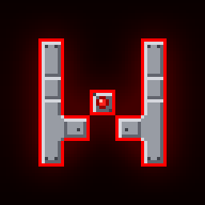

# AutoShaper

Autoplay for WAVESHAPER.

---

AutoShaper plays WAVESHAPER for you. It watches the game window and presses your keys, so
achievements are earned through normal runs. It doesn't touch the game's files or memory.

## Download

Grab `autoshaper.exe` from the [latest release](https://github.com/kaankutluturk/autoshaper/releases/latest)
and run it. No installer. If Windows SmartScreen complains, click More info, then Run anyway.

## Using it

Insert shows or hides the menu. Home starts or stops. Both can be rebound under misc.
The menu has a taskbar button while open; its tray icon can show or hide the menu, or unload AutoShaper.

The autoplay tab plays a run up to the score you set, then ends it so the game saves it. Tick loop
to keep going until the total score achievements are done.

The achievements tab does the rest with one button. It reads your progress from Steam, picks the
game mode in the menus and works through whatever is still locked. The one it can't do is the
friends leaderboard achievement.

Play windowed, and start runs with the keyboard. If you last picked a menu item with a controller,
the game ignores keyboard input.

## Limits

Scores stop at 420 on Normal and 260 on Hard, the highest score achievements, so leaderboards stay
fair. Attempts and full heals stop where their achievements do too.

The danger zone under misc can lift the score cap for autoplay. It can also bring your high scores
back down to 420 / 260 if you've gone past them (close the game first for that one).

## Files

Settings and logs live in `Documents\AutoShaper`. For the custom sprite achievement it briefly puts
a sprite in `%APPDATA%\WAVESHAPER\Sprites` and removes it afterwards. If something goes wrong,
right-click the status bar to open the logs and attach the latest one to an issue.

## Building

Run `build.ps1`. `bin\autoshaper-cli.exe --self-test` runs the tests.

---

Not affiliated with GAMES FOR HUMANS or WAVESHAPER. [MIT](LICENSE) licensed.

